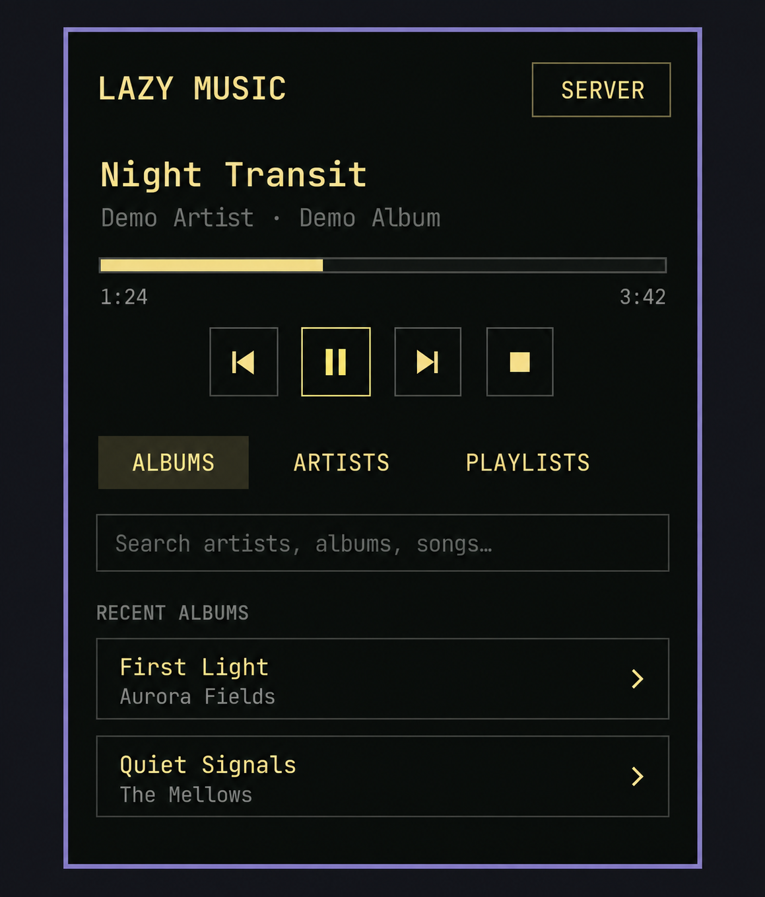
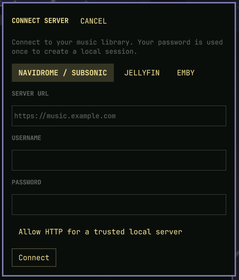

# Omarchy Lazy Music Player

A small, text-only music player for the Omarchy bar. It connects directly to Navidrome or another Subsonic-compatible server, Jellyfin, or Emby. No artwork is loaded or shown.



*Illustrative preview with fictional library data.*

## Install and connect

Requires Omarchy Shell, Python 3, `mpv`, and a music server. Run this in a terminal to install and enable Lazy Music:

```sh
omarchy plugin add https://github.com/philhurtu99/omarchy-lazy-music.git --enable
```

Confirm the install when prompted. The bar widget defaults to the right section.
While this repository is private, the command requires a GitHub account with access to it.

Click the bar widget. On first open, select **Navidrome / Subsonic**, **Jellyfin**, or **Emby**, and enter the server URL, username, and password. Use HTTPS unless the server is on a trusted local network and you explicitly enable HTTP. The **Server** button opens setup again if you need to switch servers. Emby URLs may be entered with or without a trailing `/emby`.



The password is used to authenticate and is not stored. A private session is stored at `~/.config/omarchy/lazy-music/session.json` with `0600` permissions, outside the plugin folder. Subsonic uses a salted token; Jellyfin and Emby use access tokens. The plugin installs no packages or system services, asks for no elevated privileges, and runs no remote installer. Its service entry runs inside the existing Omarchy Shell process.

## Playback

- Left click opens the panel. Right click toggles pause; middle click skips to the next track.
- Browse Albums, Artists, and Playlists, or search for artists, albums, and songs. Artists load in pages of 100. Select an artist to browse albums and an album to browse songs.
- **Shuffle library** starts a random mix from the full server library and fetches another random batch as the queue runs out.
- **Shuffle play** in an album or artist plays all songs from that selection in random order. **Shuffle play** in a playlist includes songs on every page.
- Large playlists are fetched once into a private local cache; the panel displays 100 tracks per page. **Refresh playlist** reloads it. **Refresh artists** reloads the artist list, including the local Subsonic cache.
- Use Previous, Play/Pause, Next, Stop, and the progress bar. Escape closes the panel.

Shell commands: `omarchy-shell shell summon lazymusic.player '{}'` and `omarchy-shell shell hide lazymusic.player`. To reopen server setup, use the **Server** button or `qs ipc -p /usr/share/omarchy/shell call lazymusic.player setup`.

## Uninstall

Stop playback before removing the plugin. Use **Stop** in the panel, or run:

```sh
python3 ~/.config/omarchy/plugins/lazymusic.player/backend.py stop
omarchy plugin remove lazymusic.player
```

Removing the plugin does not delete its private session. To remove the saved server URL and authentication token as well, run:

```sh
rm -f ~/.config/omarchy/lazy-music/session.json
```

## Data and security

The plugin runs with your user permissions inside the shared Omarchy shell. It sends your credentials only to the configured server during setup. Catalog requests and Jellyfin/Emby playback reject redirects to another origin. Subsonic authentication parameters are part of request URLs, as required by its API, so use HTTPS and consider server or reverse proxy access logs. Jellyfin and Emby use authorization headers for catalog and playback requests. For playback, a local audio relay sends those headers to the configured server; mpv receives only a loopback URL with a temporary access code.

Playback runs through local `mpv` and a Unix socket inside a `0700` runtime directory. The Jellyfin/Emby relay is a separate Python process bound to `127.0.0.1`, with its access code in a `0600` runtime file. Stop closes `mpv` and the relay. mpv starts without user scripts or configuration. Queue state in `~/.local/state/omarchy-lazy-music/` and the private playlist cache in `~/.cache/omarchy-lazy-music/` contain track metadata, but no credentials. A very large Subsonic playlist may take time on its first fetch; the response is bounded at 128 MB. Jellyfin and Emby collections are fetched in pages.

## Validate

```sh
omarchy plugin validate ~/.config/omarchy/plugins/lazymusic.player
/usr/lib/qt6/bin/qmllint -I /usr/share/omarchy/shell ~/.config/omarchy/plugins/lazymusic.player/{BarWidget,Panel,Setup,Service}.qml
python3 ~/.config/omarchy/plugins/lazymusic.player/backend.py configStatus
```
